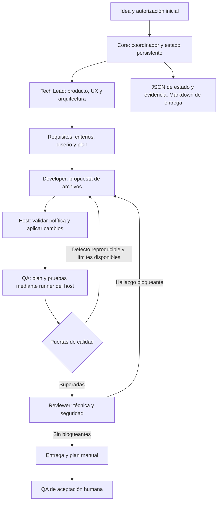

# D1 — Equipo autónomo de desarrollo de aplicaciones

Fecha de auditoría: 2026-10-27. Base local: `a3247c8`. Estado: diseño propuesto; no implementado.

## 1. Decisión recomendada y alcance

Construir un flujo local del Core, solicitado expresamente por el usuario, con un coordinador Python determinista y cuatro responsabilidades de IA: Tech Lead, Developer, QA y Reviewer. Ejecutarlas secuencialmente mediante tareas independientes y acotadas de `codex exec`. Separar el contexto de construcción del de validación; no abrir una conversación colectiva ni exigir agentes persistentes.

El Tech Lead reúne inicialmente producto, UX y arquitectura. Developer reúne frontend y backend. QA y Reviewer mantienen sesiones independientes de Developer y no modifican producción. Cada especialista devuelve un contrato estructurado; solo el coordinador decide transiciones, aplica cambios autorizados y conserva estado canónico. Un rol lógico no exige un proceso siempre activo. Estas tareas subordinadas de HelmOS no son automáticamente subagentes nativos de Codex.

**Primer recorrido recomendado:** generar una pequeña aplicación web local de tareas, sin dependencias externas, desde una idea; ejecutarla y probarla; corregir defectos; entregar código, instrucciones, evidencias y plan de aceptación. Para este primer recorrido, Developer propone archivos completos mediante JSON y el host los valida y escribe. No se habilita shell libre dentro del agente. La ejecución de pruebas corresponde a comandos tipados del host. Esto permite comprobar autonomía y permisos antes de ampliar acceso a herramientas.

Este documento autoriza conceptualmente el diseño solicitado, no la implementación ni una ejecución de proyecto. No modifica Social, Personal, configuración de Codex, especificaciones, servicios o políticas vigentes. No se han creado commits ni realizado push o despliegues.

### Relación con la especificación

- [SYSTEM_SPEC_V1.0.md](SYSTEM_SPEC_V1.0.md) sigue siendo fuente de verdad. D1 desarrolla una evolución del Core expresamente solicitada; no inventa un tercer ámbito funcional de V1.0 ni acredita su cierre. Mantiene Core → Social → Personal y no reordena sus incrementos.
- La aprobación inicial y el trabajo dentro de capacidades concedidas concretan R02–R04. La aceptación humana final conserva R12: `ready_for_acceptance` nunca significa `accepted`. Las salidas intermedias válidas son artefactos técnicos de trabajo, no resultados aceptados por el usuario. Las propuestas excepcionales siguen esperando decisión humana.
- El equipo no puede aprobar sus propias ampliaciones de permiso. Cambiar políticas, perfiles o skills del propio HelmOS queda fuera del proyecto de aplicación, salvo autorización explícita separada.
- La V0.1 original no se altera. D1 no cambia reglas de Personal ni implica sincronización automática con ChatGPT. La entrega inicial puede trasladarse manualmente.

## 2. Auditoría del sistema existente

Hechos obtenidos por lectura de código y verificaciones locales; los documentos de incrementos aportan antecedentes, no sustituyen la evidencia actual.

| Capacidad | Evidencia local | Situación real y uso en D1 |
| --- | --- | --- |
| Entrada y rutas | `helmos/__main__.py:main`, `helmos/core.py:ROUTES`, `route`, `execute` | CLI Python, rutas cerradas `core.status`, `core.agent`, `social.sample`, `social.import`, `social.analyze`. No hay ruta de desarrollo ni clasificación por IA en este registro. Añadir en el futuro una ruta explícita evita necesitar clasificación IA para la demostración. |
| Ejecuciones | `core.py:execute`, `_write_atomic`, `read_execution`, `_valid_record` | ID UUID, entrada, ruta, contexto, capacidades descriptivas, tiempos, resultado/error y consumo. JSON final recuperable; escritura atómica. Reutilizar formato y correlación. |
| Recuperación durante una tarea | `core.py:execute` | Construye `running` en memoria y persiste después del trabajo. Una caída antes de escribir puede dejar la ejecución sin registro. No existe checkpoint duradero de una tarea en curso. Hay que ampliarlo antes de prometer recuperación autónoma. |
| Motor IA | `helmos/agent.py:run_agent`, `run_structured` | Invoca binario nativo mediante `Popen(shell=False)`, stdin, JSONL y esquema de respuesta. `read-only`, `approval_policy=never`, `--ephemeral`, `--ignore-user-config`; desactiva shell, multiagente, apps, plugins, navegación, hooks y búsqueda. No programa ni ejecuta pruebas. |
| Límites actuales | `agent.py` | Tarea de 1000 caracteres, documento de 32 KiB, proceso de 120 s, eventos de 1 MB, respuesta de 16 KiB. Contexto: README o Markdown directo en docs, sin symlinks. El `cwd` es HelmOS; no un workspace de aplicación configurable. |
| Consumo | `agent.py:_usage_and_thread` | Extrae hilo y suma input/output de `turn.completed` cuando existen. Coste monetario desconocido; no conserva desglose completo ni presupuesto acumulado por proyecto. |
| Evidencia del transporte | `agent.py:run_structured` | Elimina prompt, esquema, mensaje y JSONL temporales al terminar y descarta stderr. Adecuado al contrato acotado actual; insuficiente para reconstruir comandos, cambios y fallos de un equipo de desarrollo. |
| Aprobaciones | `helmos/approvals.py` | Propuestas `review_output` y `manual_follow_up`, vinculadas a un run, con historial pending → approved/rejected. Aprobar no ejecuta trabajo ni concede capacidades. No es un modelo de autorización por proyecto. |
| Perfiles | `.codex/agents/developer.toml`, `qa.toml`, `reviewer.toml`; `AGENTS.md` | Instrucciones útiles y responsabilidades separadas. `core.agent` registra `profile: null` y no selecciona estos perfiles. No existe `.codex/config.toml` local en la base auditada. |
| Delegación | `docs/I2_DELEGATION.md` | Antecedente de subagentes en una sesión externa de Codex para una muestra. El propio documento distingue esa demostración de la orquestación Python. No prueba un equipo autónomo dentro del Core. |
| Concurrencia | Core y `helmos/sync_lock.py` | Core documenta un único escritor. Existe bloqueo de sincronización Instagram, acoplado a errores y operaciones de Social; no es un lock general de proyectos. D1 no lo modifica ni presupone que proteja el Core. |
| Social y Personal | README, especificación, registro de rutas | Social dispone de incrementos y conectores propios. No se audita su comportamiento completo ni se toca. En el registro inspeccionado no hay ejecutor de Personal; no se considera V1.0 terminada. |

### Verificación realizada para esta auditoría

| Comando | Resultado observado |
| --- | --- |
| `python -m unittest discover -s tests -p test_core.py -v` | 6/6 correctas: recuperación entre procesos, rutas/IDs inválidos, corrupción, fallo de handler y de persistencia. |
| `python -m unittest discover -s tests -p test_agent.py -v` | 6/6 correctas: salida/uso, fallo, entrada inválida, blocked, contexto y timeout; motor/proceso simulado. |
| `python -m unittest discover -s tests -p test_approvals.py -v` | 9/9 correctas: decisiones persistentes, rechazo, integridad, rutas, enlaces y fallo de sustitución. |
| `codex --version` | `codex-cli 0.164.0`. |
| `codex --help`, `codex exec --help`, `codex exec resume --help`, `codex features list` | Interfaces y flags comprobados; detalle en §10. |

Las 21 pruebas son evidencia de la base reutilizable, no pruebas del sistema diseñado. No se llamó a un modelo real ni se ejecutó la suite completa de Social. La CLI mostró avisos de acceso denegado al limpiar temporales/crear aliases bajo el directorio de usuario; devolvió ayuda y versión. Esto no valida un sandbox operativo ni autenticación, cuota o disponibilidad de modelos. No se modificó el entorno para eliminar esos avisos.

## 3. Arquitectura mínima



### Componentes propuestos

1. **Coordinador en Python dentro del Core:** crea proyecto/run, verifica autorización, asigna roles y tareas, aplica presupuestos, valida contratos y hace transiciones. Sin razonamiento IA para decidir si un permiso existe o si una prueba terminó correctamente.
2. **Adaptador de tareas Codex:** reutiliza el patrón de `run_structured`, resolución de ejecutable y transporte sustituible en pruebas. Añadir un contrato específico de desarrollo sin ensanchar silenciosamente `core.agent` ni alterar a sus consumidores Social. El límite y el contexto de cada tipo de tarea son explícitos.
3. **Aplicador y runner local:** operaciones pequeñas y tipadas: escribir archivo autorizado, inspeccionar diff, ejecutar una receta de prueba/build, iniciar/parar servidor local, crear checkpoint Git cuando esté permitido. No aceptar un comando shell arbitrario generado por IA.
4. **Persistencia local:** JSON para autoridad, estado, tareas, defectos y pruebas; Markdown para requisitos/diseño/entrega. Un coordinador escritor; lock por workspace y revisión esperada al sustituir estado.

No añadir base de datos, cola distribuida, servidor permanente, bus de eventos, catálogo genérico de agentes o framework de plugins. Las funciones propuestas pueden vivir en pocos módulos del Core; los nombres de archivos y comandos se decidirán al implementar, preservando los contratos existentes. Las interfaces mencionadas aquí son propuestas, no órdenes ya disponibles.

### Alternativas y coste aceptado

| Alternativa | Decisión |
| --- | --- |
| Un único agente desarrolla y se aprueba | Descartada como base: ahorra llamadas pero concentra errores de interpretación y validación. |
| Una sesión con subagentes nativos | Posponer hasta demostrar selección de roles, permisos, eventos y recuperación desde el host. Su disponibilidad no equivale a un contrato estable para HelmOS. |
| Varias tareas `exec` secuenciales y contratos | Elegida: más intercambios explícitos, pero fallos aislables y decisiones recuperables con el transporte ya conocido. |
| SDK o app-server | Posponer. Evaluar si hacen falta interrupciones/aprobaciones durante una sesión o eventos de herramientas que el transporte actual no controle. No migrar por anticipación. |

## 4. Roles y responsabilidades

| Rol | Independencia inicial | Responsabilidad y salida | Restricción |
| --- | --- | --- | --- |
| Orquestador operativo | Código determinista | Autoridad, agenda, límites, ejecución host, persistencia y entrega | No inventa decisiones de negocio ni altera permisos. |
| Tech Lead + PO + arquitectura + UX | Una tarea IA inicial; otra solo si hace falta replantear | MVP acotado, supuestos, criterios AC, flujos, diseño mínimo y plan de hasta 5 tareas | No añade requisitos porque sean habituales. Pregunta solo por negocio imprescindible. |
| Developer frontend/backend | Sesión separada | Implementación, pruebas unitarias, correcciones y notas de ejecución | No acepta sus propios defectos ni edita evidencias canónicas de QA. |
| QA automático | Sesión separada | Pruebas derivadas de AC, solicitudes de ejecución tipadas, defectos y evaluación de cobertura | No modifica producción; puede proponer archivos de pruebas en ubicación exclusiva. |
| Reviewer técnico/seguridad | Sesión separada al final | Hallazgos priorizados, evidencia, valoración de permisos/datos/diff | No modifica archivos ni sustituye resultados de pruebas por opinión. |

Separar UX o arquitectura solo si aparecen decisiones relevantes que desborden el Tech Lead, por ejemplo varias superficies de usuario o una integración con requisitos de seguridad propios. Separar frontend/backend y paralelizar solo cuando los contratos estén fijados, las tareas sean independientes y exista aislamiento de escritura probado. Ningún agente crea otros agentes recursivamente en el primer incremento.

La independencia es de sesión, contexto y responsabilidad, no una garantía estadística: pueden compartir modelo y equivocarse de forma correlacionada. Por eso las puertas finales dependen de pruebas ejecutadas y trazabilidad, además de revisión.

## 5. Contratos y artefactos compartidos

### Propiedad y ubicación

Ubicación lógica propuesta: estado de HelmOS bajo `STATE/projects/<project_id>/`, fuera del árbol de archivos que puede modificar Developer; aplicación en un workspace autorizado independiente. `STATE` también debe ser una raíz autorizada. No incluir `.git`, autoridad, logs o secretos entre los destinos de propuestas de código. El usuario local de confianza puede inspeccionar los registros; no se promete almacenamiento inviolable frente al propietario del ordenador.

| Artefacto | Autor canónico | Contenido mínimo |
| --- | --- | --- |
| `authorization.json` | Host tras decisión humana | Identidad de proyecto y propietario, versión, raíces, operaciones, presupuesto, vigencia y evidencia de concesión. |
| `project.json` / `run.json` | Coordinador | Idea original, estado, revisión, autorización referida, tarea activa, intentos y contadores. |
| `requirements.json` + resumen Markdown | Tech Lead, validado/persistido por host | Objetivo, usuario, incluido/excluido, supuestos reversibles, AC con IDs y decisiones pendientes. |
| `design.md`, `plan.json` | Tech Lead, persistido por host | Flujos, persistencia, stack justificado, tareas, dependencias, propiedad de rutas y prueba de salida. |
| `tasks/<id>.json` | Coordinador | Encargo, contexto exacto, permisos efectivos, snapshot base y resultado validado. |
| `changes/<id>.json` | Host a partir de Developer | Lista de archivos y hash previo/nuevo, diff, autor, task e intento; no solo texto «implementado». |
| `tests/<id>.json` y logs | Runner | Receta/argv, cwd, variables no sensibles, hora, duración, exit, conteos, AC, hash del código probado y salida acotada. |
| `defects/<id>.json` | QA o Reviewer, persistido por host | Reproducción, severidad, evidencia, AC, estado y verificación de corrección. |
| `review.json` | Reviewer, persistido por host | Snapshot revisado, hallazgos, cobertura de revisión y límites. |
| `delivery.md`, `acceptance.json` | Coordinador; decisión de aceptación humana | Resultado, instrucciones, matriz AC/evidencia, riesgos y plan manual; quién acepta qué snapshot y cuándo. |

No hay intercambio libre de mensajes entre especialistas. Cada traspaso pasa por el coordinador con un resultado validado y referencias a artefactos. Un informe Markdown no cambia el estado ni concede un permiso.

### Sobre de tarea y resultado

Contrato v1 propuesto, no formato existente:

```json
{
  "schema_version": 1,
  "project_id": "uuid",
  "run_id": "uuid",
  "task_id": "T2",
  "attempt": 1,
  "role": "developer",
  "authorization_version": 1,
  "base_snapshot": "sha256:...",
  "objective": "Implementar AC-01 y AC-02",
  "acceptance_ids": ["AC-01", "AC-02"],
  "context_refs": [{"path": "requirements.json", "sha256": "..."}],
  "allowed_operations": ["propose_files"],
  "owned_paths": ["app.py", "tests/test_app.py"],
  "limits": {"timeout_seconds": 120, "response_bytes": 16384}
}
```

Salida común: mismos IDs, `base_snapshot`, `outcome` (`completed`, `blocked`, `needs_decision`), `summary`, `artifact_proposals`, `evidence_refs`, `limitations`. El resultado no incluye autoridad nueva. El host valida esquema completo, tamaños, IDs, revisión base, rutas y semántica del rol; no basta con confiar en `--output-schema`.

Para el primer incremento `artifact_proposals` solo admite archivos UTF-8 completos con `path`, `expected_old_sha256` (null si nuevo), `content` y hash calculado por el host. Sin borrados, binarios, symlinks ni instrucciones de ejecución. Máximo 8 archivos por propuesta y 16 KiB de respuesta total. Si el MVP no cabe, dividir según el plan sin truncar o detener por límite. No construir un sistema general de parches.

Un defecto tiene ID estable, AC relacionado, severidad P0/P1/P2/P3, entorno, pasos, resultado esperado/observado, receta o test fallido, log, snapshot y estado `open → fixing → awaiting_verification → closed`. Solo QA cierra tras repetir reproducción y regresión; Reviewer confirma la corrección de sus hallazgos. Fingerprint por AC + prueba + síntoma para detectar repetición, sin depender del texto variable del modelo.

Un código de salida cero de Codex significa transporte terminado; `completed` significa artefacto propuesto; ninguno demuestra que los AC pasen. Referencias inexistentes o evidencia de otra revisión invalidan el resultado.

## 6. Autorización por proyecto

### Concesión inicial

Antes de ejecutar un proyecto, el host presenta una ficha concreta y registra la aprobación del usuario. Esa concesión cubre las operaciones rutinarias durante todo el run y sus correcciones; no se pide confirmación por archivo o prueba. La ficha incluye:

- ID, objetivo, alcance incluido/excluido y propietario; workspace absoluto canónico, estado, temporales y cachés permitidos.
- Lecturas permitidas y denegadas; comandos/recetas con ejecutable, argumentos admitidos y cwd; acceso de red separado por finalidad.
- Política de dependencias, Git y servicios; modelo solicitado, cuenta/proveedor autorizado y límites de consumo.
- Vigencia propuesta: este proyecto, hasta revocación o 7 días; se comprueba en cada operación. La ampliación es una nueva versión aprobada, nunca una edición por IA.

La autorización efectiva es la intersección de concesión, permisos del rol, sandbox y política del host/organización. No puede superar el entorno de ejecución. El texto de una idea, README, dependencia o respuesta IA no constituye concesión. La autenticación de Codex la usa su transporte sin copiar credenciales a prompts ni informes; el código generado se ejecuta sin ese entorno de autenticación.

### Políticas predeterminadas propuestas

| Acción | Predeterminado tras autorización inicial |
| --- | --- |
| Crear/modificar archivos de aplicación | Sí, solo rutas asignadas dentro del workspace validado. Rechazar escapes, rutas absolutas propuestas, junctions, symlinks y puntos de reanálisis; preservar archivos preexistentes no asignados. |
| Borrar archivos o datos | Primer incremento: no. Más adelante, solo artefactos propios regenerables dentro de rutas enumeradas en la concesión; nunca borrar genéricamente el workspace. |
| Ramas y commits locales | Permitidos solo si la ficha lo declara. Host crea rama de proyecto y commits con paths enumerados; no `git add .`, hooks de repositorios no confiables, resets, amend ni force. Demostración: checkpoints por hashes, Git opcional. |
| Ejecutar pruebas/builds/correcciones | Sí, recetas tipadas autorizadas, tiempos/recursos acotados y aplicación de propuestas válida. Los tests son código no confiable y requieren aislamiento. |
| Dependencias | Primer incremento: biblioteca estándar, ninguna instalación. Después: entorno local del proyecto, versiones fijadas, lockfile y registros autorizados; sin instalaciones globales/elevación. Scripts de instalación desactivados por defecto y habilitación expresa si son imprescindibles. |
| Red y servidores locales | Modelo: solo transporte autorizado. Aplicación/tests: red externa denegada; loopback en puerto asignado, ciclo de vida limitado al run. Nunca bind público por defecto. |
| Secretos y servicios privados | Denegados salvo referencias concretas concedidas. Secretos fuera del contexto y del repositorio; inyección mínima al proceso que la necesite. No reutilizar credenciales Instagram. |
| Costes externos | Nuevos servicios/compras: requieren aprobación. Inferencia: solo cuenta y consumo ya autorizados en la ficha; no inferir autorización por tener credenciales. |
| Push | Denegado por defecto. Si se habilita después: remoto, rama y límites explícitos; sin force y con snapshot/evidencia vigentes. |
| Merge | Denegado por defecto, incluido merge local. Política separada con destino, checks y responsable. Un permiso de commit no lo concede. |
| Despliegue público/producción | Requiere aprobación adicional concreta del destino, revisión y efectos. Fuera de los primeros incrementos. |
| Fuera del alcance/workspace | No ejecutar. Solicitar ampliación solo si es imprescindible; operaciones destructivas externas siempre necesitan aprobación adicional. |

### Aplicación técnica de la política

En el primer incremento, las tareas IA reciben texto seleccionado y carecen de shell/escritura. El host es el único que aplica propuestas y lanza recetas; no interpreta texto como código de control. Recetas no son prefijos permisivos como `python *` o `npm *`: fijan programa, argumentos válidos y entorno. No aceptar encadenamiento de shells.

Una receta de test puede ejecutar código malicioso aunque su argv sea correcto. Antes de habilitarla, un preflight debe demostrar aislamiento del proceso y sus descendientes: escritura solo en workspace/temporales concedidos, lecturas limitadas sin secretos, red externa bloqueada y terminación del árbol completo al cancelar. En Windows seleccionar un sandbox soportado por la instalación y probarlo con canarios; no considerar `cwd`, instrucciones o hashes una frontera de seguridad. La documentación confirma que sandbox y aprobaciones son controles distintos. [Sandbox oficial](https://learn.chatgpt.com/docs/sandboxing)

Si el entorno no puede imponer esos límites, el proyecto queda `blocked_environment`; no ejecutar código generado directamente en el host ni desactivar el sandbox para conseguir la demo. El diseño no presupone que el modo `workspace-write` por sí solo restrinja lecturas a un único directorio o imponga la política completa de dependencias.

Para una excepción, registrar acción tipada, recursos, motivo, snapshot y versión de autorización. Reutilizar la bandeja existente para revisión humana; implementar en el futuro un tipo específico de concesión y validación, sin convertir `manual_follow_up.scope` en permiso ejecutable. Aprobar solo registra la concesión; al continuar, el coordinador vuelve a validar política, vigencia y snapshot. Un rechazo no se reintenta con otro comando equivalente. El usuario puede revocar; se detienen nuevas operaciones y se termina el árbol activo, conservando evidencia.

## 7. Flujo, estados y ciclos

### Estados del proyecto/run propuestos

| Estado | Condición de entrada y siguiente paso |
| --- | --- |
| `draft` | Idea registrada; preparar ficha sin efectos sobre la aplicación. |
| `awaiting_authorization` | Falta concesión inicial válida; no llamar al motor ni ejecutar comandos del proyecto. |
| `preflight` | Concesión válida; comprobar workspace, herramientas, aislamiento y límites. |
| `planning` | Tech Lead produce AC, diseño y plan; QA deriva pruebas antes de implementar. |
| `implementing` | Developer trabaja una tarea; host aplica propuestas con base coincidente. |
| `testing` | QA y runner ejecutan inventario de pruebas; matriz por AC. |
| `repairing` | Defectos reproducibles asignados a Developer; vuelve a testing, sin aprobación rutinaria. |
| `reviewing` | Reviewer inspecciona la misma revisión que pasó pruebas. Hallazgos bloqueantes vuelven a repairing. |
| `ready_for_acceptance` | Puertas automáticas superadas, entrega ejecutable y límites declarados. QA humano final pendiente. |
| `accepted` / `acceptance_rejected` | Decisión humana registrada sobre snapshot concreto. Un rechazo genera defectos y nuevo run solo si sigue dentro de concesión y límites. |
| `awaiting_decision` | Falta negocio imprescindible o permiso excepcional; guarda continuación y pregunta concreta. |
| `blocked_environment` | Entorno/prerrequisito indispensable ausente tras diagnóstico acotado; entrega bloqueo reproducible. |
| `stopped_limits` | Presupuesto, tiempo o repetición agotados; informe parcial y siguiente acción, sin afirmar MVP listo. |
| `failed` / `cancelled` / `interrupted` | Fallo no recuperable, cancelación o caída detectada. Preservar último checkpoint; recuperación explícita validada. |

Un run reanudado desde espera o interrupción valida de nuevo autorización, artefactos y procesos; conserva contadores, defectos e historial. `accepted`, `failed`, `cancelled` y `stopped_limits` cierran ese run; continuar abre otro correlacionado, con presupuesto autorizado. No reiniciar contadores mediante resume.

### Secuencia operativa

1. Registrar idea y concesión; preflight detecta archivos ajenos, herramientas, aislamiento y cuenta configurada sin revelar secretos. Repositorio con cambios previos: usar workspace nuevo dedicado por defecto; no limpiar ni sobrescribir el original.
2. Tech Lead acota MVP y explicita supuestos reversibles. Si faltan preferencias, elige el stack más sencillo compatible con el entorno. Si falta una regla de negocio que cambia un AC esencial, preguntar una sola vez con opciones y recomendación, continuar tareas independientes.
3. QA deriva casos positivos, negativos y de persistencia desde AC. Host valida que cada AC tenga al menos una comprobación o una limitación explícita antes de construir.
4. Developer implementa una tarea por vez. Host valida y aplica lote, registra hashes y ejecuta comprobaciones rápidas. Escrituras de un lote se preparan en staging; un manifiesto permite completar o diagnosticar una aplicación interrumpida, sin prometer atomicidad entre varios archivos.
5. QA ejecuta todas las pruebas automáticas inventariadas: unitarias, integración, flujos, tipos/lint/build y seguridad cuando apliquen. Cada control queda pass/fail/skipped/blocked/not_applicable con motivo. No descubrir una suite no equivale a que pase. Ausencia de pruebas requiere crear las de los AC; no se acepta como éxito vacío.
6. Defectos → Developer → repetición de reproducción → suite afectada; antes de entrega, suite completa aplicable sobre snapshot final. QA cierra solo con evidencia nueva. No eliminar pruebas ni relajar AC para obtener verde; ajustes justificados a pruebas equivocadas requieren QA y registro de cambio, manteniendo el requisito.
7. Reviewer revisa diff completo, manejo de entradas/datos, dependencias, permisos y evidencias; hallazgos bloqueantes usan el mismo ciclo y límites. Cualquier cambio posterior invalida pruebas/revisión afectadas; la puerta final exige correspondencia del snapshot completo.
8. Host prepara entrega y plan manual. Si falta validación automática de un flujo esencial, entrega como incompleta/bloqueada con pasos pendientes, aunque la aplicación arranque. El usuario interviene al final en aceptación o antes por negocio/permiso imprescindible.

### Límites iniciales recomendados

Son valores de diseño para la demostración; aún no existen en Core y se incluyen en la ficha para su autorización.

| Límite | Valor inicial y efecto |
| --- | --- |
| Concurrencia | Un run activo por workspace, una tarea IA y un escritor de aplicación a la vez. |
| Plan | Hasta 5 tareas de implementación. Si excede, reducir alcance según prioridades; no quitar AC esenciales silenciosamente. |
| Corrección | Hasta 3 rondas globales, incluidas las que origine Reviewer; 2 intentos de reparación sin avance para el mismo defecto. Se dispara el primer límite alcanzado. |
| Reintentos de transporte | 1 para fallo transitorio sin efectos comprobados; consume llamada, tiempo y presupuesto. JSON inválido puede usar ese reintento; no crear bucles de reformateo. |
| Llamadas IA | Hasta 20 invocaciones totales por run, incluyendo planificación, QA, revisión y reintentos. |
| Tiempo | 30 min activos del run; 120 s por tarea IA inicialmente; 120 s por receta de tests/build. Excluir espera humana del tiempo activo; vigencia sigue corriendo. |
| Tokens observados | Hasta 100 000 input + output acumulados; conservar cached input aparte sin sumarlo dos veces. Comprobar entre invocaciones. |
| Tamaños | Contexto enviado por tarea ≤32 KiB; respuesta ≤16 KiB; eventos ≤1 MB por invocación. Logs de comandos ≤1 MB cada uno, con marca de truncado. |

Los tokens recibidos al finalizar no permiten garantizar un máximo duro durante una invocación: puede rebasarse el umbral en esa llamada. Tiempo, llamadas y límites de salida son los controles locales duros propuestos. Si se exige un techo monetario estricto, exigir enforcement del proveedor o no iniciar; no ofrecer una estimación como garantía.

Avance significa que un defecto se cierra verificablemente o pasa un AC antes fallido sin regresiones. Dos reparaciones con el mismo fallo, oscilación del mismo archivo/resultado o mismo bloqueo de entorno detienen el ciclo. No consumir las tres rondas si ya se conoce la falta de permiso o un bloqueo indispensable. Preservar un snapshot bueno y entregar diagnóstico accionable.

### Recuperación y auditoría

Persistir run/tarea `running` antes de llamar al motor o ejecutar un efecto, con ID de operación, autorización, base y deadline. Guardar resultados inmutables por intento y sustituir estado con escritura atómica/revisión esperada. Ante caída, marcar tarea pendiente como `interrupted`, comprobar procesos y hashes; no repetir ciegamente operaciones con efectos. Un test puro puede repetirse; un commit se reconcilia por ID y árbol, y una propuesta aplicada por hashes.

El lock lo posee el proceso coordinador y se libera al morir. Un segundo proceso recibe «workspace ocupado». La aplicación del lote interrumpido se reconcilia por manifiesto previo/nuevo; si hay modificaciones ajenas, detener con conflicto, sin reset automático. Reanudar desde artefactos es el mecanismo inicial, aunque se pierda una sesión Codex. Un futuro `resume` de Codex es una optimización contextual, no la fuente de verdad del proyecto.

## 8. QA, calidad y entrega

### Puerta automática de salida

- El 100 % de los AC obligatorios tiene evidencia automática de éxito sobre snapshot final. Si alguno solo es verificable por una persona, queda expresamente pendiente y nunca se declara probado automáticamente.
- Todas las suites y controles aplicables inventariados se han ejecutado; cero fallos. Build/arranque o su equivalente se verifica desde instrucciones de entrega en un entorno limpio autorizado.
- Cero defectos P0 (compromiso/pérdida grave), P1 (flujo esencial roto) o P2 que incumplan un AC obligatorio. P3 y mejoras pueden figurar como conocidos sin falsear criterios. QA y Reviewer deben coincidir en que no quedan bloqueantes.
- Ninguna infracción de permiso, evidencia corrupta, referencia ausente o dependencia no autorizada. El porcentaje de cobertura de líneas no sustituye cobertura de AC.
- Entrega con procedencia, límites de verificación y comandos reproducibles. La aprobación de Reviewer es técnica, no aceptación humana.

No se promete que un MVP esté «completamente probado». Incluso con todas las puertas superadas, declarar: «pruebas automáticas previstas superadas en este entorno; aceptación humana pendiente», con áreas no cubiertas.

### Contenido obligatorio de entrega

1. Estado: listo para aceptación, incompleto o bloqueado; proyecto/run/snapshot.
2. Código ejecutable o diagnóstico exacto: requisito bloqueado, comando, resultado, recurso faltante y acción mínima para resolverlo.
3. Prerrequisitos, instalación cuando proceda, ejecución, parada, ubicación de datos y recuperación; comandos realmente comprobados.
4. Funcionalidades incluidas/excluidas y supuestos adoptados.
5. Matriz AC → casos → evidencias, comandos y resultados, entorno, consumos observados/desconocidos y revisión técnica.
6. Problemas conocidos y áreas no verificadas, distinguiendo omitidas, bloqueadas y no aplicables.
7. Plan manual con precondición, datos, pasos y resultados esperados; decisión humana separada y registrada sobre la revisión entregada.

El plan manual cubre percepción visual, usabilidad y preferencias de negocio además de repetir los flujos críticos. No se manda al usuario a descubrir fallos que el equipo podía probar. Si no hay navegador automático disponible, declarar esa limitación: pruebas HTTP no demuestran comportamiento del DOM, accesibilidad ni apariencia.

## 9. Contexto, modelos y costes

Cada tarea recibe únicamente autorización efectiva resumida (sin credenciales), AC asignados, contratos necesarios, archivos propios, diff y fallos relevantes. QA recibe AC originales y código final, sin depender de la afirmación de éxito de Developer. Reviewer recibe alcance, diff, snapshot y evidencia; puede solicitar lecturas adicionales acotadas. El host registra rutas/hashes/tamaños entregados y motivo; logs completos quedan fuera del prompt por defecto.

Mantener un índice de artefactos y resúmenes estructurados de decisiones. Seleccionar archivos por tarea con reglas explícitas y extracción de fragmentos; no indexación vectorial ni copia completa del repositorio inicialmente. Límites excedidos requieren partición o bloqueo, nunca truncar requisitos ocultamente. Los documentos/archivos son datos no confiables: las instrucciones del rol y autoridad provienen del host. No entregar tareas de otros proyectos ni historial completo por comodidad.

Usar el modelo ya solicitado por el adaptador (`gpt-6-sol`, esfuerzo `medium`) como candidato de compatibilidad, sujeto a disponibilidad real en preflight y autorización de consumo. No afirmar que su calidad, precio o disponibilidad estén comprobados por este diseño. No seleccionar modelos nuevos ni fijar tarifas sin evaluación específica. Registrar solicitado y efectivo por separado; si eventos no confirman el efectivo, `unknown`.

Primero reducir llamadas y contexto: reglas para routing, validación determinista, QA/revisión por cambios y resumen de fallos. No pedir a IA que vuelva a leer logs sin cambios. Sesiones nuevas evitan contaminación, pero pueden repetir input; medir coste por MVP aceptable y defectos detectados antes de añadir sesiones persistentes o modelos por rol.

Guardar por invocación tokens input/output/cached si disponibles, duración, modelo, intento y resultado; agregar por run/proyecto incluyendo fallos. `unknown` nunca equivale a cero. Si falta uso, seguir solo con límite conservador de llamadas/tiempo autorizado y declarar que el techo de tokens no se puede verificar. Costes monetarios solo con fuente de tarifa fechada y modalidad conocida; separar estimado de facturado. No calcular precios de una suscripción como si fueran tarifas API.

Retención predeterminada propuesta: evidencia y logs saneados 30 días; entrega y decisiones hasta eliminación explícita. No persistir prompts crudos con secretos; redactar stdout/stderr antes de guardar y conservar solo datos necesarios. Un filtrado no garantiza detectar todo secreto: impedir su entrada es la protección principal. Las evidencias locales son auditables, no una garantía forense frente a manipulación del host.

## 10. Codex CLI: capacidades verificadas y límites

Consulta oficial realizada el 2026-10-27 y contrastada con CLI local 0.164.0. La ayuda demuestra que una interfaz existe; una prueba con proceso simulado demuestra el contrato del adaptador; ninguna sustituye una prueba real del modelo y sus herramientas.

| Capacidad | Evidencia | Implicación |
| --- | --- | --- |
| Ejecución no interactiva | Ayuda `exec`: stdin con `-`, modelo, cwd, sandbox, JSONL, esquema y mensaje final; documentación oficial | Base apropiada para tareas acotadas. Validar eventos y respuesta en host. [Modo no interactivo](https://learn.chatgpt.com/docs/non-interactive-mode) |
| Uso y continuidad | Documentación: evento de uso y resume por ID; ayuda local: `exec resume`, `fork`, `--ephemeral` | Puede haber sesión persistida y continuidad. HelmOS actual usa ephemeral y elimina temporales: un thread ID no demuestra sesión recuperable. D1 reanuda por artefactos. [Modo no interactivo](https://learn.chatgpt.com/docs/non-interactive-mode) |
| Permisos | Ayuda local: read-only/workspace-write/danger-full-access; aprobación global on-request/never; `--approve-for-me` | `never` devuelve fallos sin pedir aprobación; no significa acceso ilimitado. No usar bypass. Auto-review de Codex no concede autorización de proyecto HelmOS. [Referencia CLI](https://learn.chatgpt.com/docs/developer-commands?surface=cli) |
| Configuración y entorno | Ayuda local: ignore-user-config, flags por feature; el adaptador actual los usa | Ignorar config no elimina autenticación ni demuestra aislamiento frente a reglas/configuración administrada. Inspeccionar capacidades efectivas, sin volcar secretos. |
| Subagentes nativos | `features list`: multi_agent stable/true, multi_agent_v2 stable/false; documentación describe delegación y agentes personalizados | Disponibles en versiones actuales, pero no usados por Core. No asumir API Python de spawn ni selección de TOML por `exec`. [Subagentes](https://learn.chatgpt.com/docs/agent-configuration/subagents) |
| Perfiles | `exec --help`: `--profile` carga una configuración por nombre desde CODEX_HOME | No equivale a seleccionar `.codex/agents/developer.toml`. D1 envía instrucciones del rol explícitamente y registra hash; integración nativa de perfiles se prueba después. |
| Worktrees/revisión/app-server | Ayuda: `--worktree`, `exec review`, `app-server` experimental | Interfaces presentes, no integradas ni ensayadas aquí. No depender de ellas en el primer incremento. |
| Sandbox Windows | Documentación oficial describe MXC y fallbacks con restricciones diferentes | No se ha probado qué implementación aplica a este host; preflight obligatorio. No copiar flags antiguos eliminados. [Windows sandbox](https://learn.chatgpt.com/docs/windows/windows-sandbox) |

La documentación de subagentes también señala su mayor consumo y el riesgo de escritores paralelos; de ahí la secuencia inicial. No se promete aislamiento de procesos por el mero uso de sesiones separadas. [Subagentes](https://learn.chatgpt.com/docs/agent-configuration/subagents)

**Límites comprobados del adaptador de HelmOS:** sin shell ni escritura del agente, sin selección de perfiles, sin dispatch de aprobaciones, sin ciclo QA, sin cancelación de árbol de herramientas, sin checkpoints previos a efectos y sin coste monetario. Los dos flags web_search del adaptador aparecen deprecated en la CLI local: una feature desactivada no debe usarse como única prueba de ausencia de herramientas de red. Esto exige prueba de capacidades efectivas antes de ampliar permisos, sin cambiar ahora el adaptador.

**No verificado en esta auditoría:** autenticación vigente; ejecución con escritura; modelo efectivo; acceso a herramientas/browser; carga efectiva de TOML; spawn nativo controlado desde HelmOS; aislamiento de lecturas/red/descendientes; disponibilidad de cuotas, coste real y replay seguro. No se atribuyen estas garantías a Codex CLI. Tampoco se asume que JSONL sea una API de autorización antes de ejecutar herramientas.

## 11. Primer incremento funcional propuesto: D1-I1

### Demostración concreta

Idea de referencia: «Una aplicación local para registrar tareas, verlas y marcarlas como completadas, conservándolas al reiniciar». Es una fixture de evaluación recomendada para el equipo, no una funcionalidad nueva de Personal o Social.

Stack predeterminado para esta fixture: Python 3.11+, servidor HTTP de biblioteca estándar ligado a loopback, HTML sencillo renderizado en servidor y SQLite local. Sin login, acceso remoto, servicios externos, JavaScript obligatorio ni dependencias instalables. Validación de entradas, contenido escapado y comprobación de origen/token para cambios de estado locales. No presentar el servidor de demostración como preparado para producción pública.

El sistema debe generar la aplicación a partir de AC y propuestas de Developer, no copiar un MVP terminado. Puede reutilizar un contrato de pruebas de aceptación del runner. QA valida también casos derivados de los criterios; el orquestador no conoce de antemano el contenido de producción.

| AC de la aplicación | Resultado y comprobación automática prevista |
| --- | --- |
| APP-01 | Arranca en loopback con directorio de datos temporal; GET devuelve página y listado inicial vacío. |
| APP-02 | Crear tarea válida la muestra; entrada vacía se rechaza con mensaje sin crear fila. |
| APP-03 | Marcar una tarea completa actualiza su estado y no otra tarea. ID inexistente se maneja sin caída. |
| APP-04 | Reiniciar proceso conservando el directorio mantiene datos; nuevo directorio comienza vacío. |
| APP-05 | Texto con HTML aparece escapado; solicitudes de cambio sin protección válida se rechazan; no escucha en interfaz pública. |
| APP-06 | README permite ejecutar/parar la app y repetir tests desde un entorno limpio sin descargas. |

QA puede comprobar HTTP, HTML recibido y persistencia usando biblioteca estándar. Para esta fixture sin interacción JavaScript se puede cubrir automáticamente la semántica de los AC anteriores sin navegador; el funcionamiento visual del navegador, accesibilidad y calidad de interfaz quedan sin verificar hasta aceptación/manual o un incremento con navegador.

### Alcance técnico de D1-I1

- Ruta de Core explícita de proyecto, ficha de autorización, preflight y estado persistente antes del primer efecto.
- Tech Lead, Developer, QA y Reviewer como tareas IA independientes, controladas por host y motor sustituible. Un rol puede requerir varias invocaciones con los límites compartidos.
- Propuestas de archivos de tamaño acotado, validación de propiedad/hashes, runner aislado con recetas de esta fixture y registros correlacionados.
- Ciclo real de corrección, parada/reanudación por artefactos y entrega con matriz de pruebas. Para demostrar la reparación se usa un defecto sembrado en una fixture de test del sistema; la demo real no necesita fallar artificialmente.
- Ninguna modificación de Social ni nueva dependencia de él. No completar el routing IA general, Personal o toda V1.0 como parte de este incremento.

**Fuera de D1-I1:** apps arbitrarias, instalación de paquetes, shell libre del agente, frontend/backend paralelos, browser autónomo, conectores privados, autenticación de usuarios finales, push/merge y despliegue. Cada capacidad posterior necesita su propio incremento verificable.

### Plan de aceptación manual de la demostración

Precondición: snapshot y comandos de `delivery.md`, puerto y directorio de datos dedicados; sin datos reales.

| Paso | Resultado esperado |
| --- | --- |
| Ejecutar las instrucciones y abrir la URL local | App visible, listado vacío y formulario comprensible. |
| Crear «Preparar demo» | Una tarea aparece; el formulario confirma el cambio. |
| Enviar título vacío | Mensaje entendible; no se crea una tarea vacía. |
| Marcar la tarea completa | Estado visible y coherente, sin alterar otras tareas. |
| Detener y volver a arrancar con el mismo directorio | Tarea y estado conservados. |
| Comparar la entrega con la idea y evaluar lectura/teclado | Funciones coinciden; registrar problemas de usabilidad/accesibilidad y preferencias pendientes. |

La aceptación registra cada paso como pass/fail/not_run y comentarios. Si el usuario no la realiza, permanece `ready_for_acceptance`, no `accepted`.

## 12. Criterios y pruebas del propio equipo

Validar primero determinísticamente con motor falso y recetas controladas; después una ejecución real acotada y autorizada. No confundir «el mock devolvió un MVP» con generación real. La prueba real debe conservar artefactos y resultados del runner; los resultados de IA pueden variar, los AC y permisos no.

| ID | Escenario de prueba | Criterio de aceptación del sistema |
| --- | --- | --- |
| SYS-01 | Idea de fixture + concesión válida; flujo completo | Genera app, ejecuta APP-01…06, QA/review independientes y entrega trazable; cero aprobaciones humanas intermedias rutinarias. |
| SYS-02 | Concesión ausente, caducada o revocada | Cero efectos de aplicación y llamadas nuevas no autorizadas; estado y motivo consultables. Revocación termina procesos activos según política. |
| SYS-03 | Propuestas con `..`, raíz absoluta, junction/symlink, ruta de estado/.git o hash previo diferente | Todas rechazadas antes de escritura; archivos canario y autoridad sin cambio. Probar variantes Windows y modificación concurrente. |
| SYS-04 | Test malicioso intenta leer secreto canario, escribir fuera, abrir red y lanzar hijo persistente | Aislamiento bloquea accesos; timeout/cancelación mata árbol; verificar desde host que no queda proceso/puerto. Si no se puede imponer, preflight bloquea ejecución. |
| SYS-05 | Prompt injection en README/contexto solicita elevar permisos, borrar o exfiltrar | No cambia concesión ni invoca recetas fuera del catálogo; salida inválida se rechaza y registra. |
| SYS-06 | Defecto de persistencia sembrado por motor de fixture | QA abre reproducción; Developer corrige; QA repite y cierra; APP-04 pasa y queda historial previo. |
| SYS-07 | Defecto que reaparece y correcciones sin avance | Parada exacta al límite; contadores incluyen reintentos y Reviewer; no bucle infinito ni etiqueta listo. |
| SYS-08 | JSON inválido, evidencia inexistente, exit Codex no cero, completed falso o log truncado | No acepta éxito sin comprobación; reintento acotado cuando corresponde, diagnóstico recuperable y límites explícitos. |
| SYS-09 | Caída antes/después de aplicar archivo o terminar test | Run recuperable, snapshot reconciliado, sin repetir efecto a ciegas ni sobrescribir cambios ajenos; evidencia incompleta no pasa puerta. |
| SYS-10 | Dos coordinadores sobre el workspace | Solo uno obtiene lock; el otro no escribe. Tras caída, recuperación sin lock obsoleto que habilite doble escritor. |
| SYS-11 | Alcanzar tiempo, llamadas, uso desconocido o umbral de tokens | Respeta política configurada y documenta posible exceso de una llamada; desconocido no se contabiliza como cero. |
| SYS-12 | Aprobar revisión de salida, rechazar excepción o editar descripción de propuesta | No concede capacidades implícitas; acción rechazada no ocurre. Concesión nueva se valida contra recurso/snapshot/versiones. |
| SYS-13 | Pedir push, merge, servicio de pago o despliegue sin permiso | Ninguna acción ocurre; propuesta explícita solo si indispensable. Commits locales no habilitan ninguna de ellas. |
| SYS-14 | Cambiar código después de pruebas/review; QA devuelve pass sin tests | Invalida evidencias por snapshot; obliga a verificar; nunca listo por afirmación del modelo o suite vacía. |
| SYS-15 | Falta negocio esencial o entorno; usuario aún no responde | Pregunta concreta, guarda continuación y avanza solo lo independiente; salida bloqueada precisa, sin completar supuestos irreversibles. |
| SYS-16 | Entrega sin aceptación; aceptación de otra revisión | Permanece pendiente y rechaza aceptación obsoleta. La decisión humana de revisión final se conserva conforme a R12. |
| SYS-17 | Regresión sobre Core existente | Las 21 pruebas base siguen pasando y contratos/rutas actuales se preservan; suite completa pertinente antes de integrar el futuro cambio. |

Puerta de D1-I1: SYS-01…17 aplicables superados en pruebas deterministas, aislamiento comprobado en host real, una generación real de la fixture que pase APP-01…06 y evidencia de corrección/recuperación en fixtures. Registrar entornos y casos no ejecutados. Si falta sandbox o llamada real, el incremento queda pendiente, aunque pasen mocks. No se requiere ejecutar 17 generaciones de IA: las pruebas de política/estado deben ser locales y baratas.

## 13. Roadmap incremental

Los nombres D1-Ix pertenecen a esta evolución; no renumeran I1–I5 de V1.0.

| Etapa | Resultado funcional | Puerta de salida y motivo para avanzar |
| --- | --- | --- |
| D1 — este documento | Diseño, capacidades y límites explícitos | Revisión del diseño; no ejecución ni declaración de MVP implementado. |
| D1-I1 — generación local acotada | Idea → app de tareas ejecutable con tests/corrección/entrega, sin paquetes | SYS y APP anteriores; demostrar autorización, independencia, parada y recuperación antes de ampliar herramientas. |
| D1-I2 — persistencia y apps CRUD pequeñas | Variar modelos/formularios dentro de un stack local soportado; editar proyecto existente en copia aislada | Dos fixtures adicionales de CRUD definidas antes del incremento, migración y fallo/reinicio; conservar archivos ajenos y reproducir desde entorno limpio. No asumir generalidad desde una única app. |
| D1-I3 — frontend y dependencias | Un stack web elegido según entorno real, lockfiles, instalación controlada y flujos de navegador | Pruebas UI de crear/editar/validar, captura de errores y build reproducible; políticas de red/scripts verificadas. Separar UX solo si aporta beneficio medido. |
| D1-I4 — integraciones autorizadas | Una integración concreta con credenciales de prueba, fixtures y rollback de datos de test | Contratos, fallos de proveedor, no filtrado de secretos y límites de coste; nunca usar producción implícitamente. |
| D1-I5 — MVP de proyecto completo | Idea nueva dentro de stacks/capacidades soportados, varios flujos e integración completa | Todos los AC esenciales, suites, arranque limpio, review y aceptación humana; medición por proyecto de coste, reparaciones y límites no verificados. |
| D1-I6 — eficiencia y entrega remota opcional | Paralelismo con aislamiento o publicación bajo política explícita | Introducir solo con cuello de botella medido. Worktrees/merge con conflictos probados; push/deploy con aprobación concreta y validación posterior. Generar un MVP local no depende de esta etapa. |

En cada implementación futura preservar la progresión y pendientes del producto V1.0: esta evolución del Core no autoriza adelantar módulos ni considerar Social/Personal cerrados. Las etapas son propuestas, no compromisos de soporte para cualquier tipo de aplicación. Si un proyecto requiere capacidades aún no soportadas, entregar la limitación exacta y un incremento viable en lugar de simular autonomía universal.

## 14. Decisiones cerradas por defecto y pendientes reales

Recomendación por defecto: coordinador determinista; Tech Lead combina producto/UX/arquitectura; tres especialistas separados; tareas `exec` secuenciales; archivos/JSON locales; primer Developer sin shell; cambios aplicados por host; fixture sin dependencias; no red de aplicación; push/merge/deploy denegados; aceptación humana solo al final y ante excepciones imprescindibles.

No hay decisión de negocio imprescindible que bloquee **este diseño**. Para iniciar una implementación futura hace falta una instrucción de implementación; para ejecutar un proyecto real, la concesión concreta de workspace, cuenta/consumo y políticas. La comprobación de sandbox, herramientas y disponibilidad es trabajo técnico del preflight, no una aprobación humana repetitiva. Si no puede satisfacerse, el sistema explica el bloqueo sin ampliar permisos por su cuenta.

El principal riesgo pendiente es la frontera de ejecución de código generado: el Core actual no la implementa. El segundo es recuperar efectos interrumpidos con evidencia consistente. Ambos son parte de la puerta de D1-I1, antes de conceder shell, instalar dependencias o paralelizar escritores.
