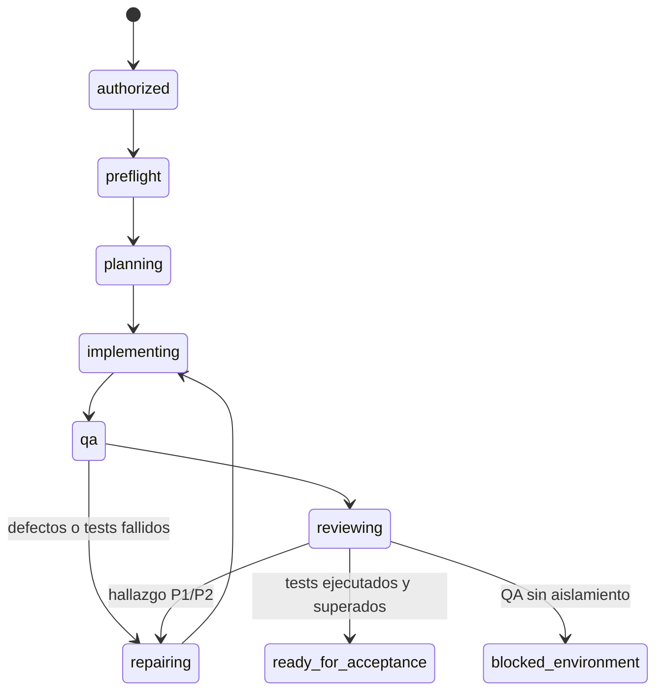

# D2 — Primer circuito autónomo de desarrollo

Fecha: 2026-10-27. Fuente funcional: [V1.0](SYSTEM_SPEC_V1.0.md). Diseño: [D1](D1_AUTONOMOUS_DEV_TEAM_DESIGN.md).

**Actualización posterior:** [QA desbloqueado con MXC y reparación real verificada](D2_QA_UNBLOCK.md). La continuación completa termina `ready_for_acceptance`, con 253 pruebas del sistema correctas. Este documento conserva el diagnóstico y la primera demostración parcial como antecedente; la evidencia nueva está enlazada en la actualización.

**Resultado:** circuito implementado y probado determinísticamente; demostración con Codex real realizada parcialmente. **El circuito autónomo completo no está validado en esta instalación.** El backend nativo disponible no permite el perfil de lecturas restringidas exigido para ejecutar código generado. No se ha eliminado esa protección para obtener una demostración verde.

## Arquitectura implementada

CLI Core → coordinador determinista → planificación → Developer → aplicación de archivos por el host → QA y receta fija → Reviewer → reparación automática o entrega. Las invocaciones Codex son secuenciales, nuevas y sin herramientas. No son subagentes nativos de una sesión interactiva. El host conserva un único escritor del proyecto y un lock de kernel por workspace en el directorio de estado.

Se reutilizan `agent.run_structured`, la resolución del binario nativo, el transporte stdin/JSONL/esquema y sus límites. Se han añadido únicamente dos parámetros opcionales: directorio de trabajo y timeout. Los valores predeterminados y el contrato de `core.agent` se conservan. Ningún consumidor Social cambia. El adaptador sigue desactivando shell, multiagente, plugins, apps, navegador y hooks, usando sandbox read-only, aprobación never y configuración de usuario ignorada.

Se reutilizan `_write_atomic`, `read_execution` y la bandeja `review_output`: al cerrar, la ejecución se recupera con `show`, y la entrega genera una propuesta de revisión humana. Aprobar esa propuesta no ejecuta acciones, no concede permisos y no cambia el proyecto a aceptado. La autorización inicial es explícita y distinta de esa revisión final.

El registro del circuito usa `input.operation = core.devteam` como metadato de correlación. La entrada implementada es el subcomando `devteam`; no se añadió una ruta parcialmente operativa a `run` ni clasificación IA general.

### Archivos

| Archivo | Responsabilidad |
| --- | --- |
| `helmos/devteam.py` | Concesión inicial, máquina de estados, presupuestos, invocaciones, reparaciones, recuperación, registro Core y entrega. |
| `helmos/devteam_contracts.py` | Instrucciones y esquemas distintos para planificación, Developer, QA y Reviewer; validación local completa del subconjunto de esquemas usado. |
| `helmos/devteam_runtime.py` | Snapshot y aplicación validada de archivos; lock; preflight con canarios; receta fija unittest mediante sandbox Codex. |
| `helmos/devteam_demo.py` | Repositorio Git ficticio nuevo, petición de normalización de etiquetas y ejecución explícita de la demo. |
| `helmos/agent.py` | Extensión compatible de cwd/timeout; no se amplían las capacidades de los agentes. |
| `helmos/__main__.py` | Comandos devteam y errores controlados. |
| `tests/test_devteam.py`, `tests/test_devteam_runtime.py` | Coordinación, política, fallos, límites, contratos, recuperación y frontera del runner. |
| [evidence/D2_REAL_DEMO.json](evidence/D2_REAL_DEMO.json) | Evidencia exportada de las cuatro llamadas reales, propuestas, revisión, snapshots y bloqueo. |

### Estados y reparación



Además existen terminales `failed`, `stopped_limits` e `interrupted`. Los errores, timeouts o ausencia de motor se conservan en estado consultable. No hay aceptación humana automática ni transiciones ocultas basadas en texto conversacional.

En un entorno que supere el preflight, QA propone sus tests y solicita `recipe: unittest`; el host ejecuta **todos** los `test_*.py` de la raíz con Python aislado, sin bytecode. Se exige ejecución no vacía, salida cero y cero fallos, errores y saltos. Se registra snapshot, argv fijo, log acotado, duración y conteos. Un fallo reproducible vuelve a Developer; después se repite QA y revisión. Reviewer puede devolver trabajo mediante P1/P2 aunque las pruebas hayan pasado. P3 queda documentado y no bloquea por sí mismo.

Si el aislamiento falla, el host puede aplicar las propuestas de texto validadas, pero **no ejecuta** sus tests. Reviewer recibe un resultado `blocked`, no un falso verde. Puede señalar errores estáticos y provocar correcciones; si no encuentra errores, la entrega continúa bloqueada por entorno.

## Contratos de los especialistas

Todos reciben la petición original, archivos seleccionados, plan, defectos abiertos y último resultado del runner. Reviewer recibe también los archivos iniciales para inspeccionar cambios. No se transmiten conversaciones ni historial completo. Contexto máximo: 32 KiB; proyecto hasta 24 000 bytes, 16 archivos; salida del adaptador hasta 16 KiB y 8 archivos por lote. Los excesos producen fallo explícito, sin truncar requisitos.

| Rol | Salida específica | Restricción |
| --- | --- | --- |
| Planner/Tech Lead | `acceptance`, `steps`, `manual_qa` | Plan acotado y criterios de aceptación, sin efectos sobre código. |
| Developer | `files: [{path, content}]` | Archivos completos de producción/documentación/tests propios; no puede modificar `test_qa_*.py`. |
| QA | `files`, `recipe: unittest`, `defects`, `coverage` | Solo archivos raíz `test_qa_*.py`; solicita ejecución al host, nunca afirma haberla realizado él mismo. |
| Reviewer | `defects`, `manual_qa` | Sin archivos ni comandos; inspección independiente y plan manual. |

El sobre común es `outcome: completed|blocked`, `summary`, `limitations`. Cada defecto contiene `id`, `severity: P1|P2|P3`, `path`, `reproduction`, `expected`, `observed`. El host añade número de intento, rol, estado, hilo, consumo, hash del contexto y snapshot. No se interpreta ninguna propiedad como comando. Claves extra, tipos incorrectos y resultados incoherentes se rechazan localmente, además del esquema solicitado a Codex.

`completed` de un especialista significa propuesta terminada, no prueba superada. `coverage` es una explicación del QA; no es una medición de cobertura ni una garantía automática de que todo criterio esté probado. La revisión debe valorar esa correspondencia. Una validación semántica más fuerte de AC por test queda pendiente.

## Autorización, seguridad y límites

La concesión se crea solo con `--authorize --fictional`. Registra petición, workspace canónico, operaciones tipadas y presupuesto. No hay aprobación por archivo o corrección. La autoridad reside en JSON del host separado del workspace, con hash de integridad; no en README, código, prompts o mensajes del modelo. El hash detecta divergencia entre registros y no pretende resistir manipulación deliberada del usuario dueño del host.

Alcance D2: repositorios **ficticios**, planos, con archivos Python de nombre ASCII minúsculo y `README.md`; `.git` se ignora. No se leen instrucciones de repositorio como `AGENTS.md`: un proyecto con ese archivo queda fuera del formato admitido. Se rechazan rutas absolutas, traversal, streams, enlaces simbólicos, junctions/puntos de reanálisis, hardlinks y nombres de dispositivo Windows en propuestas. QA y Developer tienen permisos distintos. Se valida el lote entero antes de escribir el primer archivo y el snapshot antes de cada sustitución. No hay borrados ni comandos propuestos por agentes.

El runner solo construye una receta definida en código host. Selecciona un perfil efímero de nombre único para evitar heredar otro perfil de usuario con el mismo nombre: lectura mínima de runtime, Python de la instalación en lectura, workspace de ejecución en escritura y red desactivada. No se guardan cambios en configuración Codex. Se filtra el entorno para no transmitir claves/tokens a los tests; se ejecuta Python con `-I -B`. Los tests siguen siendo código no confiable: el filtrado de entorno no sustituye al sandbox.

Preflight previsto: escritura interna permitida, lectura/escritura externa denegadas sobre un canario ficticio, denegación heredada por hijo, conexión a listener loopback bloqueada y terminación comprobada de un hijo inocuo al cancelar el árbol. Si no arranca el backend, ninguna de esas comprobaciones se considera pasada y los tests no se ejecutan. En esta instalación el bloqueo ocurre antes de los canarios. El probe no intenta leer credenciales reales.

Presupuestos predeterminados: 20 llamadas, 3 reparaciones, 1800 s de reloj desde la creación, 120 s por llamada/receta, 100 000 tokens observados. Son configurables dentro de cotas. El contador de llamadas se persiste antes de invocar; las reparaciones incluyen QA y Reviewer. Repetición exacta de los mismos defectos sin progreso detiene el ciclo; el máximo global sigue aplicando aunque el texto de un defecto cambie. No hay reintentos IA automáticos de transporte en D2.

Los tokens se comprueban entre llamadas: la última puede superar el umbral. Uso no comunicado se conserva como desconocido y siguen actuando tiempo/llamadas. Un intento interrumpido o fallido no cuenta como consumo cero conocido. Coste monetario y modelo efectivo permanecen desconocidos si no los proporciona el transporte. No se usa un estimado como techo financiero.

Push, merge, commits y despliegues no forman parte de las operaciones implementadas. No hay instalación de dependencias ni acceso a servicios privados. El bootstrap de la demo solo hace `git init` en su nuevo directorio ficticio; no crea commits.

## Persistencia y recuperación

`STATE/devteam/<id>/authorization.json` conserva concesión; `project.json` conserva estado, historial, intentos, plan, fuentes iniciales/finales, defectos, recibos de prueba y revisión; `delivery.md` conserva la entrega. `STATE/runs/<id>.json` permite usar `show` del Core y vincular la propuesta de revisión final.

Se persiste antes de una llamada y antes de aplicar un lote (`pending_apply`). Cada archivo usa staging y sustitución; el conjunto de archivos no es una transacción atómica. Si se pierde el proceso con una llamada activa o un lote incierto, `resume` marca `interrupted` y no lo repite ni sobreescribe cambios ajenos. Hay evidencia para reconciliar y abrir un nuevo run. D2 no implementa rollback o reconciliación automática del lote parcial.

Desde una frontera segura no terminal, `resume` continúa la máquina con presupuesto original. Los terminales no reinician el trabajo; un snapshot terminal alterado se rechaza. Se valida la concesión de nuevo y el segundo coordinador debe adquirir el mismo lock. Este lock coordina procesos HelmOS que usan el mismo STATE; no protege frente a otro programa del usuario o dos almacenes STATE diferentes. Usar un único STATE por workspace es una condición operativa de D2.

## Comandos

Desde la raíz, Python 3.11+ y Codex CLI instalado/autenticado. No ejecutar sobre datos reales.

```powershell
# Canarios ficticios: no usa IA ni modifica la configuración.
python -m helmos --state-dir var/d2-probe devteam probe

# Demo real: crea un repositorio nuevo bajo var/d2-demos/<uuid>/.
python -m helmos.devteam_demo

# Proyecto ficticio plano existente. STATE y workspace deben estar separados.
python -m helmos --state-dir C:/ruta/estado-d2 devteam start --workspace C:/ruta/repo-ficticio --request "Añade una función pequeña con unittest" --authorize --fictional --max-calls 12 --max-repairs 2 --max-seconds 900 --max-tokens 100000

python -m helmos --state-dir C:/ruta/estado-d2 devteam show <id>
python -m helmos --state-dir C:/ruta/estado-d2 devteam resume <id>
python -m helmos --state-dir C:/ruta/estado-d2 show <id>
python -m helmos --state-dir C:/ruta/estado-d2 approvals show <approval-id>

python -m unittest discover -s tests -v
git diff --check
```

`devteam` devuelve 0 solo para `ready_for_acceptance` o probe superado; 1 para entregas bloqueadas/no listas y 2 para errores de entrada/entorno gestionados por CLI. `show` muestra información sin invocar IA; el código de salida del `devteam show` conserva si está listo o no. No hay que interpretar una demo con salida 1 como fallo no diagnosticado: consultar su entrega y error.

## Demostración real observada

CLI `codex-cli 0.164.0`; Python local 3.14. La primera tentativa dentro del sandbox anidado terminó antes de IA por acceso denegado a temporales. Se repitió la demostración fuera del entorno anidado mediante la aprobación de ejecución correspondiente; no se desactivó el sandbox de los especialistas ni del runner.

Experimentos previos: MXC informó `native MXC is unavailable on this executor`; el sandbox nativo con perfil general pudo imprimir `SANDBOX_OK`. Esto solo acreditó arranque con ese perfil, no el aislamiento necesario. El perfil restrictivo usado por D2 devolvió:

```text
windows sandbox failed: Restricted read-only access requires the elevated Windows sandbox backend
```

No se instalaron cuentas, servicios, reglas de firewall ni otro backend. La documentación oficial diferencia MXC, elevated y unelevated y señala sus distintas garantías de lectura/red. [Windows sandbox](https://learn.chatgpt.com/docs/windows/windows-sandbox). El perfil restrictivo se construye con la sintaxis oficial de permisos, sin grant de lectura `:root`. [Permisos](https://learn.chatgpt.com/docs/permissions).

Proyecto real: `789dc918-e1e4-4492-8987-063e429c31e8`. Repositorio ficticio: `var/d2-demos/40d738aa-1c27-41cf-aa70-83b8fd176d5e/fictional-repository`. Artefactos de ejecución: directorio `state/devteam/<id>` hermano de ese repositorio. Copia revisable: [D2_REAL_DEMO.json](evidence/D2_REAL_DEMO.json).

Petición: añadir `normalize_tags(text)` con separación por comas, trim, minúsculas, eliminación de vacíos/duplicados manteniendo orden y TypeError para entradas no string; tests y ejemplo README.

| Etapa real | Evidencia | Resultado |
| --- | --- | --- |
| Planificación | Hilo `01a17ef0-b770-7930-a1a2-822dfe7c3843`; 13 805 tokens observados | 5 criterios, plan y pasos manuales. |
| Developer | Hilo `01a17ef0-d403-7532-bc0f-e2c4b43eae3e`; 14 379 tokens | Propuestas aplicadas por host: `tags.py`, `test_dev_tags.py`, `README.md`. |
| QA independiente | Hilo `01a17ef0-fc3f-78b3-bf40-6d6e70710c2f`; 15 381 tokens | `test_qa_tags.py` con 6 métodos de prueba, incluidos vacíos, duplicados y tipos; solicitó unittest. **No se ejecutaron.** |
| Reviewer independiente | Hilo `01a17ef1-31e2-7c83-8439-fce57638b30c`; 15 068 tokens | Sin defectos concretos por inspección; declaró que los tests no estaban verificados y entregó plan manual. |
| Entrega | `blocked_environment`, 4 llamadas, 58 633 tokens, 0 reparaciones | Código y tests propuestos, límites, plan manual y revisión humana pendiente. Ningún éxito de QA inventado. |

El snapshot final del repositorio se contrastó con el registrado antes de exportar la evidencia. Las escrituras de aplicación fueron únicamente las propuestas validadas dentro del workspace; los agentes no recibieron un canal de escritura ni comandos. La prohibición de escapes se verifica con pruebas de aplicación host y canarios ficticios. **No se acredita una prueba negativa nativa de todos los accesos externos:** el backend bloqueó el arranque de ese experimento.

La reparación real no se provocó artificialmente: no hubo un defecto observado por Reviewer y los tests no pudieron ejecutarse. QA → reparación → QA y Reviewer → reparación → QA → Reviewer están demostrados con fixtures deterministas, no con una ejecución real que haya corregido un fallo reproducido. Por tanto los puntos de ejecución real de QA y corrección real de la demostración obligatoria siguen pendientes.

## Validación del sistema

Las nuevas pruebas verifican autorización ausente, escapes y permisos por rol, validación de lotes antes de escritura, hardlinks, lock, entrega/registro Core/aprobación, correcciones desde QA y Reviewer, límites de llamadas/tokens/tiempo/reparaciones, contrato inválido, transporte bloqueado, consumo desconocido y recuperación sin replay. Las pruebas de runtime verifican receta fija, ausencia de grants amplios, tests vacíos/saltados/terminados y fallos cerrados del probe. Todos los repositorios y secretos canario son ficticios.

Las pruebas deterministas sustituyen motor y runner en los casos de coordinación: acreditan la máquina y política, no un sandbox funcional. La ejecución real citada acredita que el adaptador puede invocar el modelo y obtener/aplicar propuestas distintas por rol. No acredita QA ejecutado, recuperación de un proceso real de Codex o terminación de descendientes en este host.

## Límites conocidos y siguiente paso

1. **Bloqueante para cerrar D2:** backend con lecturas restringidas, red y descendientes verificables. No basta con aprobar una receta ni con un modo workspace-write. Una vez disponible por una decisión operativa del propietario, repetir `probe` y la demo; conservar además una incidencia real reproducida y corregida. Esa instalación no se ha realizado como parte de este trabajo.
2. Solo proyectos Python ficticios planos y pequeños. D2 reduce deliberadamente la demo web sugerida en D1 al ejemplo de cambio con tests pedido en D2. No genera aún MVP arbitrarios ni habilita shell, dependencias o navegador.
3. El adaptador existente elimina JSONL y temporales y descarta stderr. D2 conserva resultados validados, uso, IDs de hilo y errores de transporte, pero no un registro forense de cada herramienta/evento ni el modelo efectivo. No atribuirle esa trazabilidad.
4. Recuperación conservadora: diagnóstica operaciones inciertas sin replay; no repara lotes parciales automáticamente. Concesión válida durante el límite de reloj del run, sin ampliación automática. Nuevas operaciones/stack requieren otro alcance explícito.
5. Cobertura de criterios declarada por QA y revisión estática complementaria; aún no hay un verificador semántico de aceptación independiente. Las pruebas de aplicación no son una garantía de ausencia de defectos.
6. STATE y host se consideran de confianza; no se pretende contener al usuario local malicioso, ni escritores externos que ignoren el lock.

El siguiente paso recomendado es **cerrar la validación pendiente de D2**, sin comenzar D3: resolver el backend de aislamiento por la vía autorizada, pasar preflight y repetir una ejecución real con tests y corrección reproducible. No se declara V1.0 ni un MVP completo terminado.

## Cierre técnico

| Área | Estado |
| --- | --- |
| Comportamiento solicitado | PARCIAL: circuito implementado; prueba real de QA/corrección bloqueada por entorno. |
| Contratos | VERIFICADO por pruebas: roles, archivos, estados y transporte existente; límites semánticos declarados. |
| Tests/build/lint | Resultados finales de unittest y diff registrados en la nota de validación al final. No hay build/linter adicional configurado para este Core de biblioteca estándar. |
| Migraciones | NO APLICA: nuevo estado local aislado, sin cambios de esquema Social/Personal. |
| Seguridad | VERIFICADO para aplicación host y fallos cerrados; PENDIENTE el aislamiento real necesario para ejecutar tests generados. |
| Observabilidad | VERIFICADO: estados, intentos, presupuestos, resultados y entrega recuperables; eventos crudos no retenidos. |
| Documentación | VERIFICADO: contratos, comandos, demostración y limitaciones descritos. |
| Cambios accidentales | Revisar diff y estado final; Social, especificaciones, perfiles y configuración no se modifican. |

### Resultado final de validación

- `python -m unittest discover -s tests -v`: **250 pruebas correctas**, incluidas 30 nuevas de D2, en 34,419 s. Ejecución final fuera del sandbox anidado tras fallos de permisos de temporales de ese entorno. No se modificaron las pruebas preexistentes para conseguir el resultado. Log local: `var/d2-suite-final.log`.
- `git diff --check`: correcto. Se revisaron también sintaxis de los archivos Python nuevos, UTF-8, espacios finales, enlaces locales y coherencia de IDs/consumos de la evidencia exportada.
- El documento D1 ya estaba sin seguimiento al iniciar D2 y no se ha modificado. Solo cambian entrada CLI, adaptador compatible, README y nuevos archivos D2 de código, pruebas y documentación. No hay cambios en módulos Social, especificaciones ni perfiles.
- No se realizaron commits, push, merge, despliegues, instalaciones de dependencias o cambios de configuración de la máquina. D3 no se ha iniciado. La validación real completa de D2 permanece pendiente por el bloqueo explicado.
